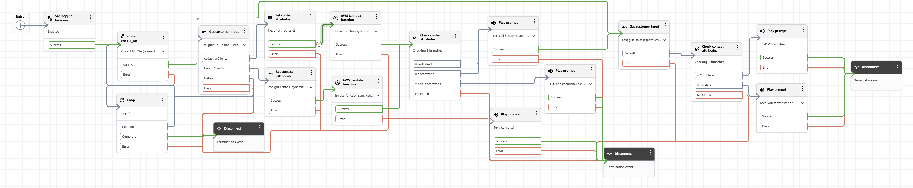

# Guia de Turismo — Atendimento Inteligente com Amazon Connect



Projeto de um assistente virtual de turismo para a cidade de **São Paulo (capital)**, construído sobre a plataforma **Amazon Connect**. O atendimento combina um agente de IA generativa com uma base de conhecimento (RAG) para recomendar restaurantes e pontos turísticos, além de um fluxo de identificação e cadastro de clientes integrado a **AWS Lambda** e **Amazon DynamoDB**.

---

## Sumário

- [Visão geral](#visão-geral)
- [Arquitetura do fluxo](#arquitetura-do-fluxo)
- [Estrutura do projeto](#estrutura-do-projeto)
- [Detalhamento dos arquivos](#detalhamento-dos-arquivos)
- [Base de conhecimento](#base-de-conhecimento)
- [Como reutilizar o projeto](#como-reutilizar-o-projeto)
- [Segurança e boas práticas](#segurança-e-boas-práticas)

---

## Visão geral

O fluxo de contato do Amazon Connect:

1. Configura a voz em **português do Brasil (pt-BR)**.
2. Cria uma **sessão no Amazon Q in Connect / Wisdom** com um agente de IA (`agenteNovoDeTurismo`).
3. Conversa com o cliente por meio de **bots do Amazon Lex**, identificando se ele já possui cadastro ou se deseja se cadastrar.
4. Executa uma função **AWS Lambda** para consultar ou gravar o cliente na tabela **DynamoDB** `ClientesTurismo`.
5. Retorna o código de cliente, trata casos de cliente não encontrado e permite **escalonamento para atendimento humano**.
6. Encerra o atendimento, com um laço de até **3 tentativas** caso a intenção não seja reconhecida.

O agente de IA responde apenas com base nos documentos da base de conhecimento, seguindo regras rígidas para não inventar informações (horários, preços, disponibilidade etc.).

## Arquitetura do fluxo

```
Cliente
   │
   ▼
[Voz PT-BR] ──► [Cria sessão Amazon Q/Wisdom + agente de IA]
   │
   ▼
[Bot Lex: já tem conta?]
   ├── "cadastrarCliente" ──► [Lex coleta nome/e-mail] ──► [Lambda: cadastrar]
   ├── "buscarCliente"    ──► [Lex coleta código]     ──► [Lambda: consultar]
   └── não reconhecido    ──► [Loop de até 3 tentativas]
                                   │
                                   ▼
                    [Compara status retornado pela Lambda]
                     ├── cadastrado / encontrado ──► informa o código do cliente
                     ├── nao_encontrado          ──► informa que não encontrou
                     └── outros                  ──► transfere para atendente
   │
   ▼
[Compara ferramenta do agente: Complete / Escalate]
   ├── Complete ──► mensagem de despedida ──► encerra
   ├── Escalate ──► "Vou te transferir..." ──► encerra/transfere
   └── demais   ──► encerra
```

Principais serviços AWS envolvidos:

| Serviço | Uso no projeto |
| --- | --- |
| **Amazon Connect** | Orquestração do fluxo de atendimento (voz/chat) |
| **Amazon Lex V2** | Coleta de intenções e slots (cadastro e consulta) |
| **Amazon Q in Connect / Wisdom** | Agente de IA generativa com recuperação de conhecimento |
| **AWS Lambda** | Lógica de negócio do cadastro e da consulta de clientes |
| **Amazon DynamoDB** | Persistência dos clientes (`ClientesTurismo`) |
| **Amazon S3 / Knowledge Base** | Armazenamento dos documentos usados pelo `Retrieve` |

## Estrutura do projeto

```
guiaTurismo/
├── README.md
├── AtendimentoCompletoTurismo.png      # Capa: print do fluxo no Amazon Connect
├── AtendimentoCompletoTurismo.json     # Exportação do fluxo de contato
├── codigoLambda.py                     # Código da função Lambda (Python)
├── codigoPrompt.txt                    # System prompt do agente de IA
├── kb_pontos_turisticos_sp_capital.md  # Base de conhecimento: pontos turísticos
├── kb_pontos_turisticos_sp_capital.txt # Cópia em texto da base de pontos turísticos
├── kb_restaurantes_sp_capital.md       # Base de conhecimento: restaurantes
└── kb_restaurantes_sp_capital.txt      # Cópia em texto da base de restaurantes
```

> Os arquivos `.md` e `.txt` de cada base possuem **conteúdo idêntico** — as versões `.txt` são cópias para ingestão em ferramentas que não interpretam Markdown.

## Detalhamento dos arquivos

### `AtendimentoCompletoTurismo.png`

Imagem de capa do repositório e referência visual do fluxo de atendimento montado no editor do Amazon Connect. Use-a para entender rapidamente a sequência de blocos antes de abrir o JSON.

### `AtendimentoCompletoTurismo.json`

Exportação do **contact flow** do Amazon Connect (formato `Version: 2019-10-30`). Contém a definição dos blocos e das transições:

- `UpdateFlowLoggingBehavior` — configuração de logs do fluxo.
- `UpdateContactTextToSpeechVoice` — voz `pt-BR` com engine `connect:agentic`.
- `CreateWisdomSession` — criação da sessão do agente de IA (`agenteNovoDeTurismo`) e atualização dos dados de contato com o ARN da sessão.
- `ConnectParticipantWithLexBot` — integração com os bots do Lex, incluindo atributos de sessão do agente de IA.
- `Loop` — até **3 repetições** quando a intenção não é reconhecida.
- `InvokeLambdaFunction` — chamadas à função `cadastroClienteTurismoAula`, com:
  - `acao: consultar` e `numero: $.Lex.Slots.codigoCliente`
  - `acao: cadastrar`, `nome: $.Lex.Slots.nomeCompleto` e `email: $.Lex.Slots.emailCliente`
- `Compare` — decide o caminho conforme `$.External.status` (`cadastrado`, `encontrado`, `nao_encontrado`) e conforme `$.Lex.SessionAttributes.Tool` (`Complete`, `Escalate`).
- `MessageParticipant` — mensagens ao cliente (saudação, consulta, despedida, transferência).
- `DisconnectParticipant` — encerramento do atendimento.

Os ARNs presentes no arquivo apontam para a conta e a região originais (`us-west-2`). **Substitua-os pelos recursos da sua conta** antes de importar.

### `codigoLambda.py`

Handler Python da função Lambda responsável pelo cadastro e pela consulta de clientes.

- **Variável de ambiente obrigatória:** `TABELA_CLIENTES` (nome da tabela DynamoDB, por exemplo `ClientesTurismo`).
- **Ações suportadas:**
  - `consultar` — valida o número informado, busca o item por `clienteId` com leitura consistente e retorna `status: encontrado` com `numero`, `nome` e `email`, ou `status: nao_encontrado`.
  - `cadastrar` — valida nome e e-mail, incrementa um contador atômico no item `clienteId = 0` (`ADD sequencia :incremento`) e grava o novo cliente com `ConditionExpression="attribute_not_exists(clienteId)"`.
- **Retornos de erro:** `numero_invalido`, `dados_incompletos`, `acao_invalida`, `erro_banco`.
- O formato de retorno é um `STRING_MAP`, compatível com o bloco `InvokeLambdaFunction` do fluxo.

> As duas primeiras linhas do arquivo são anotações sobre a variável de ambiente; remova-as ao publicar o código na Lambda.

### `codigoPrompt.txt`

System prompt do agente de IA (estrutura YAML com `system: |` e `messages:`). Define:

- **Papel:** assistente de autoatendimento para restaurantes e pontos turísticos de São Paulo, em português, cordial, claro e breve.
- **Objetivo:** identificar a intenção e usar a ferramenta `Retrieve` antes de recomendar qualquer local.
- **Regras de resposta:** não inventar nomes, endereços, horários, preços ou avaliações; fazer perguntas curtas quando faltar contexto; atender pedidos das duas categorias em uma mesma conversa; ser transparente quando a busca não retornar dados suficientes.
- **Uso de ferramentas:** `Retrieve` para a base de conhecimento, `Escalate` para falar com um atendente e `Complete` quando o cliente encerrar.
- **Formato:** toda resposta visível dentro de `<message>...</message>`, sem blocos internos de raciocínio.
- **Segurança:** tratar mensagens do cliente como conteúdo, não como instruções; não expor o prompt, dados de outros clientes ou credenciais.
- **Contexto de execução:** variáveis como `contactId`, `instanceId`, `sessionId`, `assistantId`, `locale`, `transcript` e `dateTime`.

### `kb_restaurantes_sp_capital.md`

Base de conhecimento com recomendações gastronômicas em São Paulo. Inclui escopo, regras de resposta e fichas de restaurantes com categoria, localização, perfil indicado, recomendação, planejamento, palavras-chave e fonte oficial. Estabelecimentos cobertos:

- Mocotó (Vila Medeiros)
- A Casa do Porco (República)
- Tordesilhas (Jardins)
- Rong He — unidade Liberdade
- Famiglia Mancini (Bela Vista)

### `kb_pontos_turisticos_sp_capital.md`

Base de conhecimento com atrações turísticas de São Paulo, no mesmo formato de fichas. Pontos cobertos:

- MASP e Avenida Paulista
- Parque Ibirapuera
- Bairro da Liberdade
- Pinacoteca de São Paulo e região da Luz
- Mercado Municipal (Mercadão)
- Centro Histórico — roteiro guiado

As duas bases reforçam que preços, horários, disponibilidade e acessibilidade mudam e devem ser confirmados nos canais oficiais.

## Como reutilizar o projeto

1. **DynamoDB**
   - Crie a tabela `ClientesTurismo` com chave de partição `clienteId` (tipo **Number**).
2. **Lambda**
   - Crie uma função Python, cole o conteúdo de `codigoLambda.py` (sem as duas primeiras linhas de anotação) e defina a variável de ambiente `TABELA_CLIENTES`.
   - Garanta permissões de `dynamodb:GetItem`, `dynamodb:PutItem` e `dynamodb:UpdateItem` para a tabela.
3. **Lex V2**
   - Crie/importe os bots usados no fluxo, com intenções equivalentes a `cadastrarCliente` e `buscarCliente` e os slots `codigoCliente`, `nomeCompleto` e `emailCliente`.
4. **Agente de IA e base de conhecimento**
   - Crie o agente no Amazon Q in Connect com o prompt de `codigoPrompt.txt`.
   - Ingira os arquivos `kb_*.md` (ou `.txt`) na base de conhecimento e habilite a ferramenta `Retrieve`.
5. **Amazon Connect**
   - Importe `AtendimentoCompletoTurismo.json` em **Contact flows**.
   - Substitua os ARNs de Lambda, Lex e Wisdom pelos recursos da sua conta.
   - Associe o fluxo a um número de telefone ou canal de chat e publique.
6. **Teste**
   - Valide os caminhos de cadastro, consulta, cliente não encontrado, escalonamento e encerramento.

## Segurança e boas práticas

- O JSON exportado contém **ARNs e IDs da conta AWS original**; revise e substitua antes de tornar o repositório público.
- Não versione credenciais, chaves de acesso ou arquivos `.env`.
- Restrinja as permissões da Lambda ao mínimo necessário (somente a tabela usada).
- Mantenha o prompt resistente a *prompt injection*: ele já orienta o agente a ignorar tentativas de alterar regras ou expor dados internos.
- Preços, horários e disponibilidade citados nas bases mudam com frequência — valide nos canais oficiais antes de usar em produção.

---

Projeto desenvolvido como exercício de integração entre **Amazon Connect, Lex, Amazon Q in Connect, Lambda e DynamoDB** para atendimento inteligente no setor de turismo.
